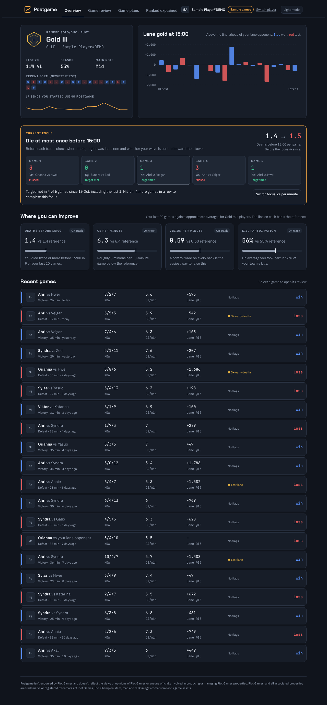

# Postgame

Coaching on your own League of Legends ranked games. Postgame runs on your own computer: a small Python server fetches your last 20 Ranked Solo/Duo games with your Riot development key, and a single page shows where you lose games and what to practise next.

## What it shows

- **Overview:** rank, recent form, LP over time, lane gold at 15:00 per game, and your averages against a reference for your rank and role.
- **Current focus:** one stat to work on, tracked game by game until you hit it five games in a row.
- **Game review:** what decided each game, team gold over time, where you died on the map, and key moments with what to check in the replay.
- **Game plans** for ahead, even and behind games, and an explainer on ranked LP and matchmaking.

## Run it

Needs Python 3.8 or newer. Nothing else to install.

- Windows: double-click `start-windows.bat`
- Mac: double-click `start-mac.command` (if macOS blocks it, right-click > Open)
- Or run `python3 server.py`

Postgame opens at http://localhost:8765. Paste a Riot development key from https://developer.riotgames.com (it expires every 24 hours), enter your Riot ID, and choose your region. To look around without a key, press **Try it with sample games**.

See `README.txt` for the plain-language setup guide included in the download.

## Privacy

Your key is saved in `riot_key.txt` and your games in `data/`, both next to the app and both ignored by git. The server only listens on 127.0.0.1.

Postgame isn't endorsed by Riot Games and doesn't reflect the views or opinions of Riot Games or anyone officially involved in producing or managing Riot Games properties.
